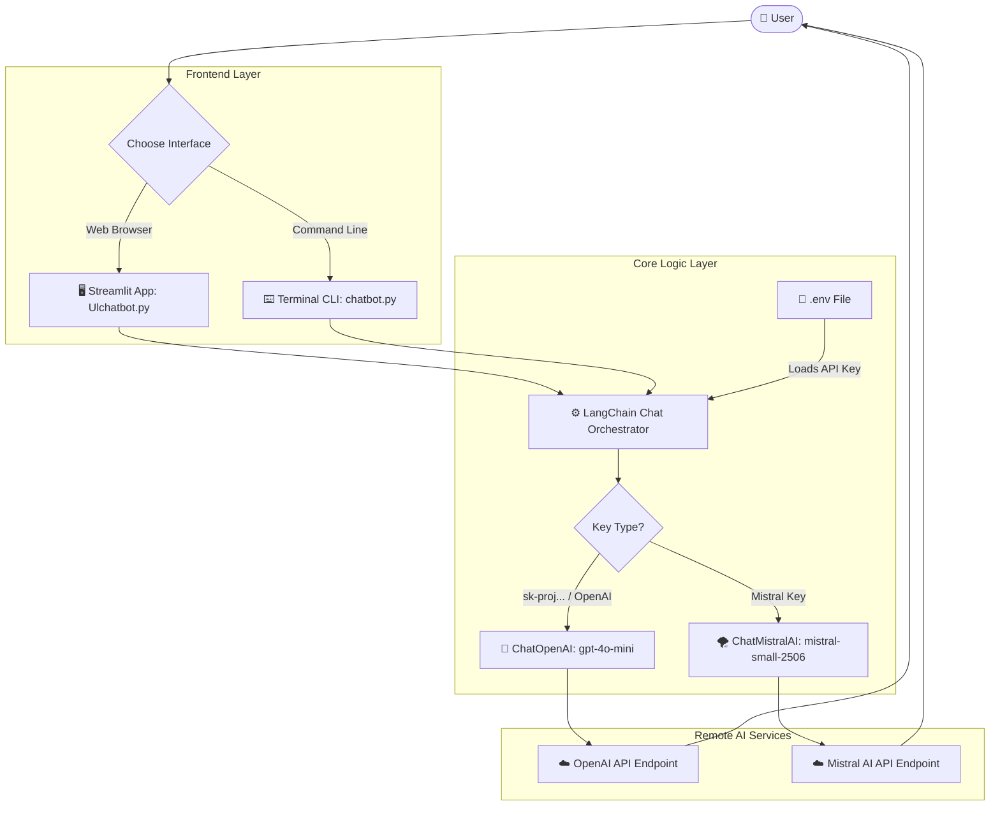
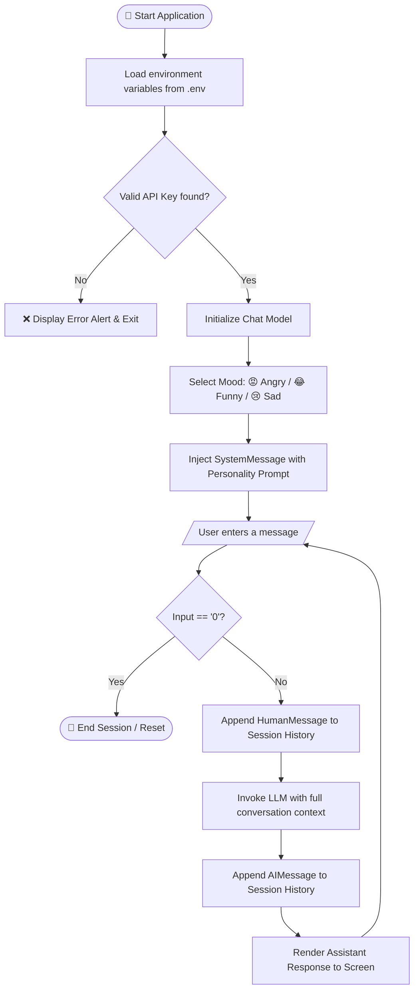

# 🎭 Mood-Based AI Chatbot

<p align="center">
  
  
  
  
</p>

> **An interactive, mood-adaptive AI chatbot capable of switching between Angry 😡, Funny 😂, and Sad 😢 personas on the fly.**  
> Built with **LangChain**, featuring dual interfaces: an interactive **Streamlit Web UI** and a lightweight **Terminal CLI**.

---

## 📑 Table of Contents

- [🌟 Features](#-features)
- [📊 System Architecture & Flowchart](#-system-architecture--flowchart)
- [📂 Project Structure](#-project-structure)
- [📦 Requirements & Tech Stack](#-requirements--tech-stack)
- [🔑 Environment Configuration](#-environment-configuration)
- [🚀 Quick Start Guide](#-quick-start-guide)
  - [Option A: Launch Web UI (Streamlit)](#option-a-launch-web-ui-streamlit)
  - [Option B: Launch Terminal CLI](#option-b-launch-terminal-cli)
- [🎭 Personality Modes](#-personality-modes)
- [🛠️ Troubleshooting Guide](#️-troubleshooting-guide)

---

## 🌟 Features

* **🎭 Dynamic Mood Personalities**:
  * 😡 **Angry Mode**: Quick-tempered, aggressive, and impatient.
  * 😂 **Funny Mode**: Witty, humorous, and full of punchlines.
  * 😢 **Sad Mode**: Melancholic, emotional, and poetic depression.
* **⚡ Multi-Model Flexibility**: Auto-detects and seamlessly runs on either **OpenAI** (`gpt-4o-mini`) or **Mistral AI** (`mistral-small-2506`).
* **💻 Dual Interfaces**:
  * **Web Dashboard**: Modern chat bubble UI with one-click mood selector.
  * **Terminal Console**: Lightweight command-line loop for fast prototyping.
* **🛡️ Smart Error Handling**: Gracefully catches missing dependencies, bad keys, or empty inputs without crashing.

---

## 📊 System Architecture & Flowchart

### 🏛️ High-Level System Architecture



---

### 🔄 Interactive Conversation Flowchart



---

## 📂 Project Structure

```text
D:\gen AI\
│
├── 📜 chatbot.py          # Terminal CLI implementation (input loop)
├── 🌐 Ulchatbot.py        # Streamlit web application (rich UI)
├── 🔐 .env                # Secret environment variables (API keys)
├── 📋 requirements.txt    # Python package dependencies
├── 📘 README.md           # Aesthetic project documentation
├── 🧪 test.py             # Basic LangChain installation check
└── ⚙️ locolmodal.py       # Local HuggingFace experiment script
```

---

## 📦 Requirements & Tech Stack

| Category | Technology | Purpose |
| :--- | :--- | :--- |
| **Language** | `Python >= 3.9` | Core runtime environment |
| **Framework** | `LangChain Core` | Prompt templating & message abstractions |
| **Providers** | `langchain-openai` / `langchain-mistralai` | LLM connector integrations |
| **Web Frontend** | `Streamlit` | Real-time reactive web dashboard |
| **Config** | `python-dotenv` | Secure API key injection from `.env` |

### Dependency File (`requirements.txt`)

```text
python-dotenv
langchain
langchain-core
langchain-mistralai
langchain-openai
streamlit
```

---

## 🔑 Environment Configuration

Create or edit your `.env` file located in the root project folder:

### If using OpenAI (Recommended with your current key)
```env
OPENAI_API_KEY="sk-proj-your-openai-api-key-here"
```

### If using Mistral AI
```env
MISTRAL_API_KEY="your-mistral-api-key-here"
```

*(Mistral API keys can be generated at [console.mistral.ai](https://console.mistral.ai/))*

---

## 🚀 Quick Start Guide

### 1️⃣ Activate your Virtual Environment

Open your terminal in `D:\gen AI`:

```powershell
# In PowerShell:
.\myenv\Scripts\Activate.ps1

# In Command Prompt (CMD):
myenv\Scripts\activate.bat
```

### 2️⃣ Install Dependencies

```powershell
pip install -r requirements.txt
```

---

### Option A: Launch Web UI (Streamlit)

Run the dedicated Streamlit interface file:

```powershell
python -m streamlit run Ulchatbot.py
```

* Opens automatically in your browser at `http://localhost:8501`.
* Select personality using radio toggles at the top.
* Chat naturally in the bottom input bar.
* Click **🔄 Reset Chat** to clear memory.

---

### Option B: Launch Terminal CLI

For direct command-line chatting without opening a browser:

```powershell
python chatbot.py
```

**Terminal Preview:**
```text
Choose your AI mode:
press 1 for Angry mode
press 2 for Funny mode
press 3 for Sad mode
Tell your response (1/2/3):- 2
----------------- Welcome! Type 0 to exit -----------------
You : Why did the chicken cross the road?
Bot : To escape people asking why it crossed the road! 🐔
You : 0
Bot : Goodbye!
```

---

## 🎭 Personality Modes

| Personality | System Instruction | Tone & Behavioral Characteristics |
| :---: | :--- | :--- |
| **😡 Angry** | `You are an angry AI agent. You respond aggressively and impatiently.` | Sarcastic, short-fused, uses exclamation points, questions user intelligence. |
| **😂 Funny** | `You are a very funny AI agent. You respond with humor and jokes.` | Punny, upbeat, lighthearted, inserts humor and playful punchlines into answers. |
| **😢 Sad** | `You are a very sad AI agent. You respond in a depressed and emotional tone.` | Melancholic, sighs heavily, perceives questions as pointless or tragic. |

---

## 🛠️ Troubleshooting Guide

| Issue | Cause | Solution |
| :--- | :--- | :--- |
| **`HTTP 401: Invalid API Key`** | An OpenAI key (`sk-proj-...`) was being passed to Mistral endpoints. | Install `langchain-openai` via `pip install langchain-openai` or insert a valid Mistral key in `.env`. |
| **Input prompt hangs inside Streamlit** | Running `streamlit run chatbot.py` instead of `Ulchatbot.py`. | Always run the web UI with: `python -m streamlit run Ulchatbot.py`. |
| **`ModuleNotFoundError: langchain_openai`** | Package not installed in the current Python environment. | Run `pip install langchain-openai`. |
| **PowerShell script execution disabled** | Windows security policy restricting script activation. | Execute `Set-ExecutionPolicy -Scope CurrentUser -ExecutionPolicy RemoteSigned` in PowerShell. |

---

<p align="center">
  Crafted with ✨ for your Generative AI Chatbot Project
</p>
